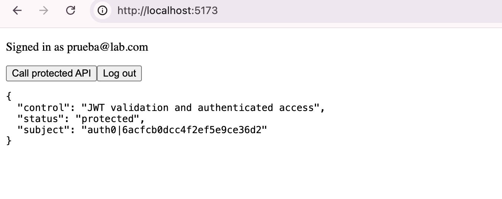
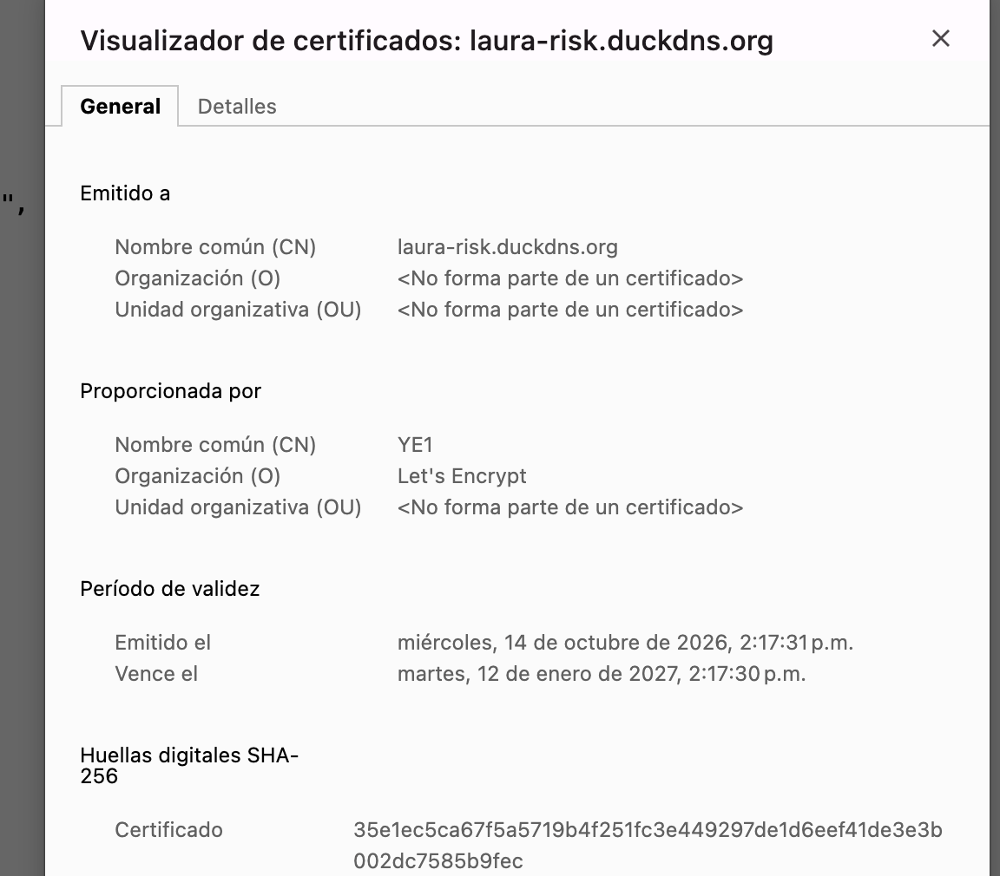

# Enterprise Risk Shield Lab
Laura Gutierrez
**Course:** Enterprise Architectures, Escuela Colombiana de Ingeniería Julio Garavito

## Deployed URL

https://laura-risk.duckdns.org

## What is it about?

In this lab I built a small web application, but designed with security in mind from the beginning. The idea was to see how several security measures work as **risk controls** for a company, meaning concrete ways to reduce what could go wrong.

The application has two parts:

- **React frontend:** a simple page where the user logs in with Auth0 and can then call the API.
- **Spring Boot backend:** an API with a single endpoint, `/api/risk-status`, which only responds if the request includes a valid token.

Everything is published on the internet over HTTPS, using a free Duck DNS domain, Apache as the web server, and a Let's Encrypt certificate.

## How does the flow work?

1. The user opens the page and clicks **Log in**.
2. Auth0 displays the login screen and verifies who they are (this is **authentication**).
3. Auth0 gives the frontend an **access token** (a JWT) intended specifically for my API.
4. The frontend calls the API by sending the token in the `Authorization: Bearer <token>` header.
5. The backend checks that the token is real, that it was issued by my Auth0 tenant, and that it is intended for my API. If everything is correct, it responds; otherwise, it returns `401` (this is **authorization**).

In short: authentication answers *"who are you?"* and authorization answers *"can you do this?"*.

## Architecture

```
Browser
  │ login and access token
  ▼
Auth0 ───────────────► React frontend ── Bearer token ──► Spring Boot API
                                                        │
Internet ── Duck DNS ── Apache + TLS ──────────────────┘
```

Apache receives all traffic over HTTPS (port 443). It serves the frontend files and forwards requests that start with `/api/` to the backend, which only runs locally on port 8080. This means the backend is never directly exposed to the internet.

## Repository structure

```
backend/    Spring Boot API (Java 21, Maven)
frontend/   React application (Vite) with Auth0
images/     Lab evidence
```

## How to run it locally

**Backend**

```bash
cd backend
mvn spring-boot:run
```

If I call `http://localhost:8080/api/risk-status` without a token, the response is `401 Unauthorized`, which is exactly what is expected.

**Frontend**

```bash
cd frontend
cp .env.example .env.local   # and put the SPA Client ID here
npm install
npm run dev
```

Then I open `http://localhost:5173`, log in, and use the **Call protected API** button.

## How I deployed it

To publish it, I used an AWS EC2 virtual machine running Ubuntu. These were the main steps:

1. *Domain:* I created the laura-risk.duckdns.org subdomain in Duck DNS and pointed it to the machine's public IP.
2. *Firewall:* in AWS and on the server (with ufw), I only left ports 22 (SSH), 80, and 443 open. The backend's port 8080 is not open to the internet.
3. *Backend:* I built the JAR on my computer, copied it to the server, and ran it as a systemd service. It runs with an unprivileged user (riskapi) and only listens on 127.0.0.1, so only Apache can communicate with it.
4. *Frontend:* I built React with npm run build and copied the dist folder to /var/www/enterprise-risk-frontend, which is served by Apache.
5. *Apache:* I configured it to serve the frontend and forward everything that starts with /api/ to the backend.
6. *HTTPS:* with Certbot, I requested a free Let's Encrypt certificate. Certbot configured Apache to use it and redirect HTTP to HTTPS. I also tested automatic renewal with sudo certbot renew --dry-run.
7. *Auth0:* I added https://laura-risk.duckdns.org as an allowed URL for login, logout, and web origins.

## Verification

| Test | Result |
|---|---|
| Call /api/risk-status without a token | 401 Unauthorized |
| Call the API after logging in | Responds with "status": "protected" and my user identifier |
| Open https://laura-risk.duckdns.org | Loads with a lock icon and a valid Let's Encrypt certificate |
| Try to connect through port 8080 from the internet | No response |
| sudo certbot renew --dry-run | Simulated renewal works |

## Evidence

**Successful API call with an authenticated user**



**Valid certificate on the public domain**



## Risk controls

| Control | Risk reduced | Evidence |
|---|---|---|
| Auth0 authentication | Identity impersonation and insecure password handling | Auth0 login flow and user identity |
| JWT validation in the API | Unauthorized access to the API | `401` when there is no valid token |
| Audience validation | Reusing a token from another API | The API only accepts tokens with the `https://enterprise-risk-api` audience |
| HTTPS with a valid certificate | Theft of credentials or tokens in transit | Certificate details in the browser |
| Apache as a reverse proxy | Directly exposing the application port | Only ports 80 and 443 are open |
| Service logs | Delaying incident investigation | `journalctl -u enterprise-risk-api` |

## Things I considered

- The `.env.local` file is not uploaded to the repository.
- The frontend only uses the Auth0 **Client ID**, never a Client Secret, because everything in the browser is visible to anyone.
- CORS only allows the exact development and production origins.
- The backend runs with an unprivileged system user (`riskapi`) and not as root.
- When configuring Auth0, I learned that the SPA needs **User-Delegated Access** to the API; *Client Access* is for machine-to-machine applications and is not suitable for a user who logs in from the browser.
